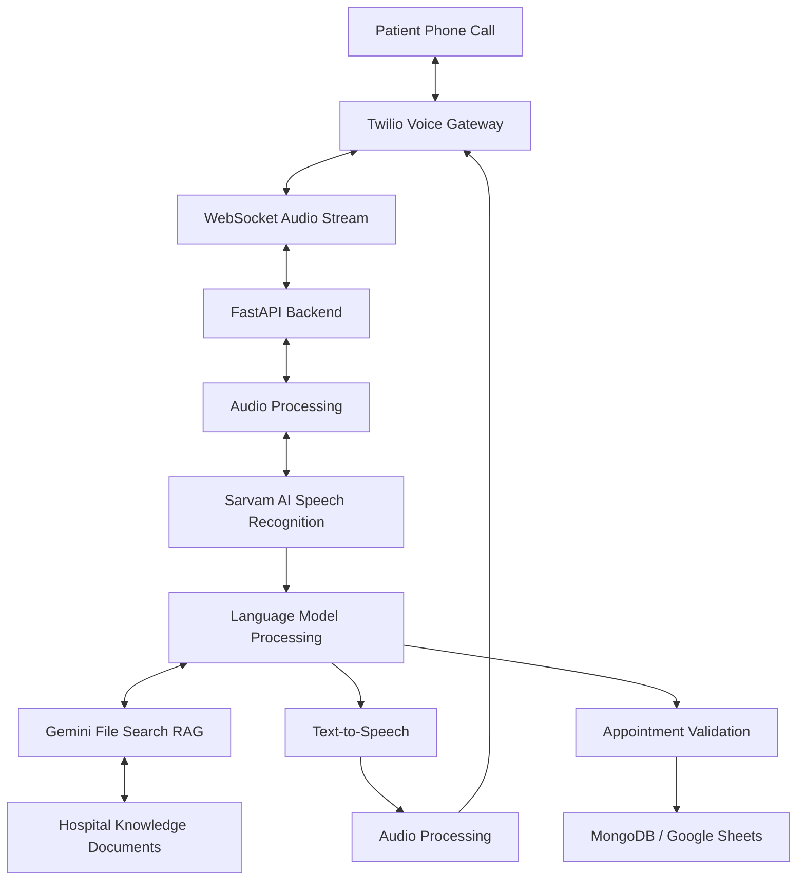

# 🏥 Anurag AI Hospital — Multilingual AI Voice Assistant

<div align="center">


**An AI-powered voice assistant concept for hospital inquiries and appointment workflows.**

Built with Python, FastAPI, Sarvam AI, Twilio, and Retrieval-Augmented Generation (RAG).

[](https://www.python.org/)
[](https://fastapi.tiangolo.com/)
[](#technology-stack)
[](#testing)
[](LICENSE)

</div>

---

## 📌 Overview

**Anurag AI Hospital** is a customized multilingual AI voice assistant project designed to help automate routine hospital reception interactions over phone calls.

Patients may ask about hospital timings, consultation fees, doctor schedules, and appointment procedures. The assistant combines speech processing, language models, and document retrieval to process requests and generate spoken responses.

This repository is a personalized customization of an existing open-source project, with improvements to branding, configuration, Windows compatibility, error handling, testing, and documentation.

> **Developer:** Anurag Deshmukh  
> **Project domain:** Voice AI | Generative AI | AI Engineering  
> **Original project:** [Sarvam Voice Agent by Srinath S](https://github.com/SrinathS-21/Sarvam-Voice-Agent)

## 🎯 Problem Statement

Hospital reception teams frequently handle repetitive calls about doctor availability, consultation timings, fees, and appointment scheduling. Answering every routine inquiry manually can increase workloads and waiting times.

Traditional text-based chatbots may also be inconvenient for callers who prefer speaking over a regular phone call.

## 💡 Proposed Solution

The project uses a voice-based AI workflow to:

- Receive and process phone-call audio through a telephony integration.
- Convert speech into text using speech recognition.
- Process the patient's request using an AI language model.
- Retrieve relevant hospital information from a document knowledge base.
- Generate a spoken response using text-to-speech.
- Validate the required details before treating an appointment request as confirmed.

The project is intended for reception assistance, not medical diagnosis or treatment.

## ✨ Key Features

- **Voice-first interaction:** Designed to support callers through telephone communication.
- **Multilingual AI:** Uses Sarvam AI capabilities for supported language and speech workflows.
- **Real-time audio streaming:** Uses Twilio Media Streams and WebSockets in the telephony architecture.
- **Document-based responses:** Uses Google Gemini File Search for Retrieval-Augmented Generation.
- **Appointment validation:** Checks required patient and appointment details before confirmation.
- **Data integration:** Includes MongoDB and Google Sheets integration paths.
- **Pronunciation normalization:** Formats selected times and medical abbreviations for clearer speech output.
- **Windows compatibility improvements:** Includes console-encoding handling and a fallback when optional background audio dependencies are unavailable.
- **Automated tests:** Includes tests for API endpoints, configuration, appointment validation, and knowledge-retrieval behavior.

*Live functionality depends on configuration, credentials, and verification of the relevant external services.*

## 🏗️ System Architecture



### How the workflow operates

1. A patient initiates a phone call.
2. Twilio streams audio to the backend over a WebSocket connection.
3. The backend processes the audio and connects to the configured speech and AI services.
4. Relevant hospital questions can trigger document retrieval through RAG.
5. The assistant generates a response and converts it into speech.
6. Appointment requests are validated before the system treats them as confirmed.
7. Configured data integrations can store appointment information.

The diagram represents the intended application architecture. Each external integration must be configured and tested before it can be considered operational.

## 🛠️ Technology Stack

| Technology | Purpose |
|---|---|
| Python | Main programming language |
| FastAPI | Backend and API endpoints |
| WebSockets | Bidirectional real-time communication |
| Twilio Media Streams | Telephone audio streaming |
| Sarvam AI | Speech recognition, language processing, and speech generation |
| Google Gemini File Search | Retrieval-Augmented Generation (RAG) |
| MongoDB / Motor | Database integration |
| Google Sheets | Optional appointment record integration |
| APScheduler | Scheduled task support |
| Pytest | Automated testing |
| ffmpeg | Optional audio-processing support |

## 📂 Project Structure

```text
anurag-ai-hospital-voice-assistant/
├── call_trigger/
│   ├── test_call.html
│   ├── knowledge_manager.html
│   ├── trigger_call.py
│   └── README.md
├── knowledge_docs/
│   ├── hospital_faqs.txt
│   ├── doctor_schedule.txt
│   └── pricing_guide.txt
├── modules/
│   ├── audio_utils.py
│   ├── mongodb.py
│   ├── google_sheets.py
│   └── google_file_search.py
├── tests/
│   ├── test_api_endpoints.py
│   ├── test_appointment_validation.py
│   ├── test_config_and_normalization.py
│   └── test_knowledge_retrieval.py
├── config.py
├── realtime_app.py
├── upload_knowledge.py
├── requirements.txt
├── pyproject.toml
├── .env.example
├── .gitignore
├── LICENSE
├── PROJECT_WALKTHROUGH.md
├── CUSTOMIZATIONS.md
└── README.md
```

*This tree summarizes the reported project layout. Verify the actual filenames in the repository before relying on every entry.*

## ⚙️ Installation and Setup

### Prerequisites

- Windows 10/11, VS Code, and PowerShell.
- A Python version compatible with the project's dependencies.
- API credentials for the external services you intend to use.
- Optional: ffmpeg for supported audio-processing features.

> **Python compatibility:** The project was tested in the reported environment using Python 3.13.3. Check `pyproject.toml` and `requirements.txt` if installing on another Python version.

### 1. Download the repository

Download the ZIP from the GitHub repository and extract it, or clone it if Git is installed.

Open the extracted project folder in VS Code.

### 2. Create a virtual environment

Open the VS Code terminal:

```powershell
python -m venv .venv
```

Activate it:

```powershell
.\.venv\Scripts\Activate.ps1
```

If PowerShell blocks activation, use this command for the current terminal session:

```powershell
Set-ExecutionPolicy -Scope Process -ExecutionPolicy Bypass
.\.venv\Scripts\Activate.ps1
```

### 3. Install dependencies

```powershell
python -m pip install --upgrade pip
python -m pip install -r requirements.txt
```

### 4. Configure environment variables

Create a local `.env` file from the provided template:

```powershell
Copy-Item .env.example .env
```

Open `.env` and configure only the credentials required for the services you want to use.

Typical integrations may require:

- `SARVAM_API_KEY`
- `GOOGLE_API_KEY`
- `TWILIO_ACCOUNT_SID`
- `TWILIO_AUTH_TOKEN`
- `TWILIO_PHONE_NUMBER`
- `MONGODB_URI`
- `GOOGLE_SHEETS_WEBHOOK_URL`
- `NGROK_URL`

Check `.env.example` and the application configuration for the exact supported variable names and which ones are required.

**Security:** Never commit your real `.env` file, API keys, tokens, or database credentials to GitHub.

### 5. Run the diagnostic check

```powershell
python setup.py
```

### 6. Run automated tests

```powershell
python -m pytest
```

### 7. Start the application

```powershell
python realtime_app.py
```

If startup succeeds, open:

- Health check: [http://localhost:7000/health](http://localhost:7000/health)
- API documentation: [http://localhost:7000/docs](http://localhost:7000/docs)

These local URLs work only while the application is running on your computer.

### 8. Test the available interfaces

Open the HTML files from the `call_trigger/` directory in your browser to inspect the available testing interfaces.

Live telephone testing requires the appropriate Twilio configuration and a publicly reachable callback URL. A local application or HTML page alone does not establish that a real phone call works.

## 🧪 Testing

The reported local test run produced the following result:

| Test module | Purpose |
|---|---|
| `test_api_endpoints.py` | API endpoint behavior and payload validation |
| `test_appointment_validation.py` | Appointment information extraction and validation |
| `test_config_and_normalization.py` | Configuration, spoken-time formatting, and abbreviation handling |
| `test_knowledge_retrieval.py` | Knowledge-retrieval behavior and error fallbacks |

**Reported result: 17 tests passed, 0 failures.**

Some external-service behavior was tested using mocks. These results validate selected local application logic; they do not prove that live telephony, speech services, database persistence, or appointment reminders work end to end.

## 🔐 Safety and Limitations

- This is a software project and demo, not a replacement for professional medical care.
- The assistant must not diagnose conditions, prescribe medicines, or make treatment decisions.
- Hospital schedules, pricing, doctors, and service details in the sample knowledge base are demo information.
- Appointment confirmation must depend on successful validation and the actual booking operation.
- External APIs require valid credentials and network access.
- Performance claims must be measured in the configured runtime environment before being reported as results.
- Do not store real patient data in a public demo without appropriate privacy, security, and legal safeguards.

## 🚀 Future Improvements

- Expand and validate support for additional Indian languages.
- Improve observability and end-to-end latency measurement.
- Add more integration and failure-recovery tests.
- Integrate with authorized hospital scheduling systems.
- Strengthen authentication, access control, and privacy protections.
- Evaluate speech recognition quality and response accuracy with representative test cases.

## 👨‍💻 Developer

**Anurag Deshmukh**  
B.Tech Artificial Intelligence

This project is part of my learning and portfolio work in Python, backend development, Voice AI, and Generative AI integration.

## 🙏 Acknowledgment and Attribution

This repository is customized from the open-source project:

**[Sarvam Voice Agent — SrinathS-21](https://github.com/SrinathS-21/Sarvam-Voice-Agent)**

The upstream implementation and original architecture are credited to the original author. My changes focus on project personalization, configuration, Windows compatibility, error handling, tests, and documentation.

Please refer to the included `LICENSE` file for the applicable license and notices.

## 📄 License

See the [LICENSE](LICENSE) file for the complete license terms. Preserve the original author's copyright and attribution notices when redistributing the project.

---

<div align="center">

**Built for learning, experimentation, and responsible AI development.**

⭐ If you find this project useful, consider starring the repository.

</div>
