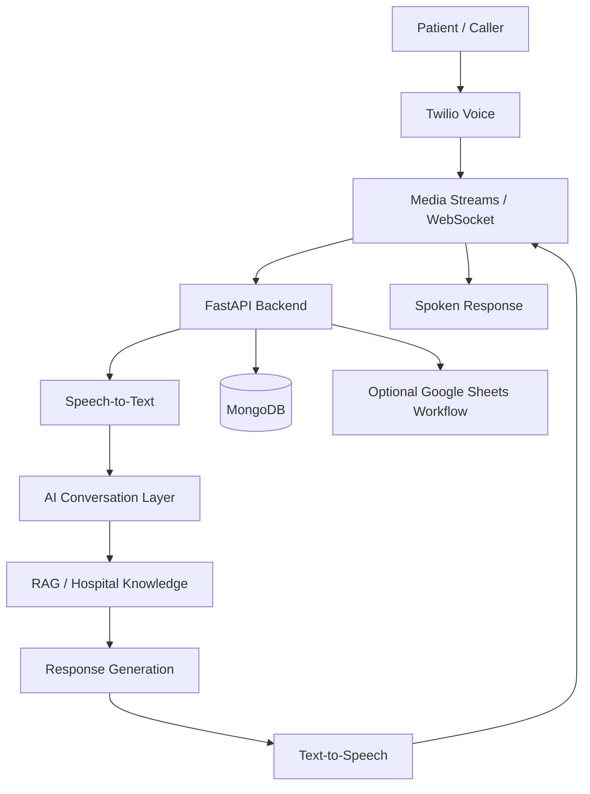

# 🏥 Anurag AI Hospital — Multilingual AI Voice Assistant

<div align="center">


**A multilingual AI voice assistant designed to simplify hospital inquiries and appointment workflows through natural voice interactions.**

Built with Python, FastAPI, Sarvam AI, Twilio, and Retrieval-Augmented Generation (RAG).


</div>

---

## 📌 Project Overview

Anurag AI Hospital is a multilingual voice-assistant project focused on making hospital information and appointment-related interactions more accessible through conversational AI.

The application combines speech processing, language-model capabilities, knowledge retrieval, and backend APIs to support voice-based interactions with hospital information.

The project brings together practical concepts from **Artificial Intelligence, Generative AI, backend development, speech technology, and information retrieval**.

## ✨ Key Features

- 🗣️ **Multilingual voice interaction** — supports speech-based conversations using integrated voice AI services.
- 🎙️ **Speech-to-Text (STT)** — converts incoming speech into text.
- 🧠 **AI-powered conversation** — processes user requests using an integrated language model.
- 📚 **Retrieval-Augmented Generation (RAG)** — uses hospital knowledge sources to help answer relevant inquiries.
- 🔊 **Text-to-Speech (TTS)** — generates spoken responses.
- ☎️ **Telephony integration** — connects voice interactions through Twilio Media Streams.
- ⚡ **Real-time communication** — uses FastAPI and WebSockets for streaming interactions.
- 🏥 **Hospital information support** — organizes knowledge for common hospital-related questions and appointment workflows.
- 🗄️ **Database integration** — uses MongoDB for supported application data workflows.

> Feature availability depends on configuration, credentials, and the status of the integrated services. Verify each workflow in your deployed environment before presenting it as production-ready.

## 🛠️ Technology Stack

| Technology | Purpose |
|---|---|
| Python | Core application logic |
| FastAPI | Backend API and application server |
| WebSockets | Real-time bidirectional communication |
| Twilio Media Streams | Telephony audio streaming |
| Sarvam AI | Speech recognition, speech generation, and language-model capabilities |
| Gemini File Search / RAG | Retrieval from configured knowledge sources |
| MongoDB and Motor | Database and asynchronous database access |
| Google Sheets integration | Optional external workflow integration |
| APScheduler | Scheduled tasks, where configured |
| HTML, CSS and JavaScript | Browser-based interaction interfaces |

## 🏗️ System Architecture



### 🔄 How It Works

1. A caller initiates a voice interaction.
2. The audio stream is received through the configured telephony integration.
3. Speech recognition converts the audio into text.
4. The backend processes the request using the configured AI conversation workflow.
5. The retrieval layer provides relevant information from available hospital knowledge sources.
6. The response is converted into speech.
7. The generated audio is returned through the configured voice channel.

## 📂 Project Structure

The structure below is representative. Keep the exact paths synchronized with the files in your repository.

```text
anurag-ai-hospital-voice-assistant/
│
├── realtime_app.py
├── config.py
├── requirements.txt
├── pyproject.toml
├── setup.py
├── .env.example
├── .gitignore
│
├── knowledge/
│   └── Hospital knowledge documents
│
├── upload_knowledge.py
├── PROJECT_WALKTHROUGH.md
├── tests/
│   └── Test modules
│
├── README.md
└── LICENSE
```

## 🚀 Getting Started

### 1. Prerequisites

Install the following:

- Python version supported by the project dependencies
- Git
- A code editor such as VS Code
- API credentials for the services you intend to use
- A Twilio account and configured voice webhook for telephony testing
- MongoDB access if database features are enabled

### 2. Clone the Repository

```bash
git clone https://github.com/AnuragPravinDeshmukh/anurag-ai-hospital-voice-assistant.git
cd anurag-ai-hospital-voice-assistant
```

### 3. Create a Virtual Environment

**Windows PowerShell**

```powershell
python -m venv .venv
.\.venv\Scripts\Activate.ps1
```

If PowerShell blocks activation, use Command Prompt or activate the environment using the method supported by your system.

### 4. Install Dependencies

```bash
python -m pip install --upgrade pip
pip install -r requirements.txt
```

### 5. Configure Environment Variables

Create a local `.env` file using `.env.example` as a template.

Add only the credentials required by the configured services, such as:

```env
SARVAM_API_KEY=
TWILIO_ACCOUNT_SID=
TWILIO_AUTH_TOKEN=
GEMINI_API_KEY=
MONGODB_URI=
```

Use the exact variable names expected by the application's configuration. These names are examples and may need to be adjusted to match the code.

**Security:** Never commit `.env`, API keys, passwords, or access tokens to GitHub.

### 6. Start the Application

For a FastAPI application exposed through `realtime_app.py`, the command may be:

```bash
uvicorn realtime_app:app --reload
```

Use the actual FastAPI object name and startup instructions defined in your source code.

If enabled, the API documentation is typically available at:

```text
http://127.0.0.1:8000/docs
```

A working local server alone does not confirm that external voice, AI, database, or telephony integrations are fully operational.

## 🧪 Testing and Validation

The project includes automated tests for supported application logic.

Recommended validation areas:

- Application startup and configuration
- Request handling and response formatting
- Speech-processing workflow logic
- Knowledge retrieval behavior
- Database operations
- External service error handling
- End-to-end voice interaction through Twilio

Record the actual test command, results, and any limitations from your latest run here. Mock-based tests validate the code paths they exercise but do not prove that live external services work correctly.

## 🎯 Learning Outcomes

This project provides practical exposure to:

- Building Python backend applications with FastAPI
- Understanding real-time communication with WebSockets
- Integrating third-party AI and speech services
- Applying Retrieval-Augmented Generation to domain-specific information
- Connecting telephony services to AI workflows
- Managing application configuration and secrets
- Testing integrated application components
- Understanding the challenges of deploying AI-enabled applications

## 🔮 Future Improvements

- Add more comprehensive multilingual testing.
- Improve response accuracy through evaluation of the hospital knowledge base.
- Add robust appointment confirmation and scheduling validation.
- Improve logging, monitoring, and failure recovery.
- Add authentication and access controls where required.
- Deploy the application with secure configuration and production monitoring.
- Evaluate latency, response quality, and reliability under realistic call conditions.

## 👨‍💻 About the Developer

**Anurag Deshmukh**

Artificial Intelligence Engineering | Python | Data Science | Generative AI

Interested in building practical AI applications that combine machine learning, language models, speech technology, and backend development.

- GitHub: [AnuragPravinDeshmukh](https://github.com/AnuragPravinDeshmukh)

## 📄 License and Attribution

Review the repository's existing license and attribution requirements before redistributing or modifying its code. Preserve applicable notices and acknowledge the original project where required.

This repository documents the hospital voice-assistant implementation and its development work. Refer to the source files and project walkthrough for the specific implementation details.

---

<div align="center">

**Built with Python and AI technologies**


</div>
